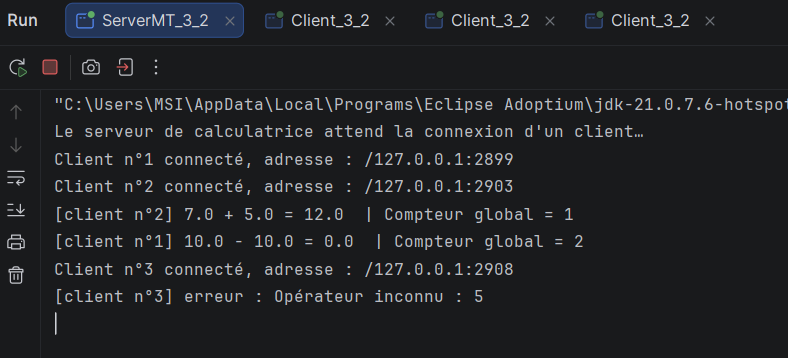
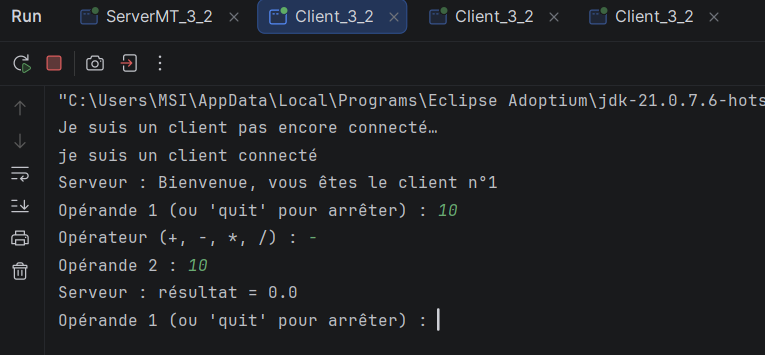
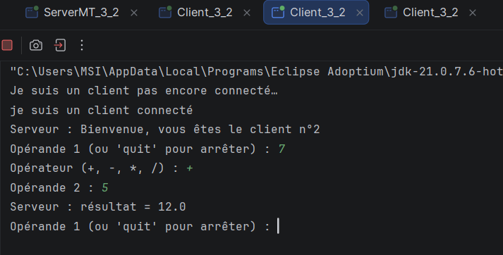
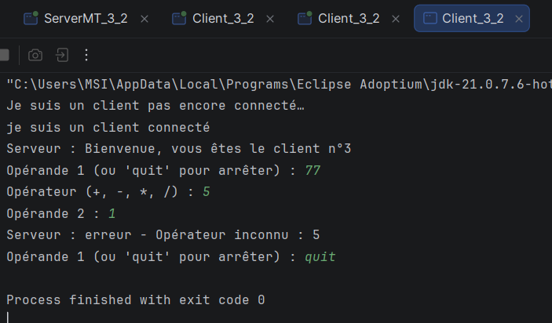

# TP 3 : Serveur multi-threads, sockets TCP en mode connecté

**Matière :** Développement d'applications réparties
**Établissement :** Faculté des Sciences de Sfax, Département d'informatique et des Communications
**Niveau :** LSI 3, année universitaire 2025 – 2026
**Type d'activité :** Individuel

## Description

Ce projet contient deux activités du TP 3 sur les serveurs multi-threads avec les sockets TCP en Java :

- **Activité 3-1 :** serveur multi-thread « echo ». Le serveur accepte plusieurs clients simultanément, crée un thread dédié par client et renvoie à chacun les messages reçus.
- **Activité 3-2 :** amélioration de l'application calculatrice. Le serveur multi-thread traite en parallèle les opérations de plusieurs clients, avec une communication par objets et un compteur global d'opérations synchronisé.

## Environnement

- JDK >= 1.8
- IDE : Eclipse, IntelliJ IDEA ou VS Code
- Git

## Structure du projet

```
src/
├── clientPackage/
│   ├── Client_3_1.java        # Client de l'activité 3-1 (messages texte)
│   └── Client_3_2.java        # Client de l'activité 3-2 (calculatrice, objets)
├── commonPackage/
│   ├── Operation.java         # Objet sérialisable envoyé par le client (opérande1, opérateur, opérande2)
│   └── Resultat.java          # Objet sérialisable renvoyé par le serveur (valeur ou message d'erreur)
└── serverPackage/
    ├── ServerMT_3_1.java      # Serveur multi-thread de l'activité 3-1
    ├── ClientProcess.java     # Thread dédié à un client (activité 3-1)
    ├── ServerMT_3_2.java      # Serveur multi-thread de l'activité 3-2
    ├── ClientProcess_3_2.java # Thread dédié à un client (activité 3-2)
    └── Compteur.java          # Compteur global partagé et synchronisé
```

## Principe de fonctionnement

### Activité 3-1 : serveur multi-thread (echo)

1. Le serveur (`ServerMT_3_1`) écoute sur le port **1234** dans une boucle infinie avec `accept()`.
2. À chaque connexion, il numérote le client et lance un thread `ClientProcess`.
3. Chaque `ClientProcess` communique avec son client indépendamment : message de bienvenue, puis écho de chaque ligne reçue, jusqu'à `quit`.
4. La communication utilise des flux texte (`BufferedReader` / `PrintWriter`).

### Activité 3-2 : calculatrice multi-thread

1. Le serveur (`ServerMT_3_2`) crée un thread `ClientProcess_3_2` par client connecté.
2. La communication se fait par **objets** (`ObjectInputStream` / `ObjectOutputStream`). Le client envoie un objet `Operation` et le serveur répond par un objet `Resultat`.
3. Opérateurs supportés : `+`, `-`, `*`, `/`. La division par zéro et les opérateurs inconnus renvoient un `Resultat` contenant un message d'erreur.
4. **Accès concurrent :** `Compteur` contient un compteur global du nombre d'opérations traitées. La méthode `incrementer()` est `synchronized`, donc un seul thread modifie le compteur à la fois. Après chaque opération réussie, le serveur affiche la nouvelle valeur du compteur dans sa console.
5. Le client envoie la chaîne `"quit"` pour se déconnecter.

> Les flux de sortie (`ObjectOutputStream`) sont créés avant les flux d'entrée, avec `flush()`, côté client et côté serveur. Sans cela, la connexion peut se bloquer.

## Exécution

### Test en local

1. Lancer le serveur :
   - activité 3-1 : `serverPackage.ServerMT_3_1`
   - activité 3-2 : `serverPackage.ServerMT_3_2`
2. Lancer un ou plusieurs clients (plusieurs instances en parallèle) :
   - activité 3-1 : `clientPackage.Client_3_1`
   - activité 3-2 : `clientPackage.Client_3_2`
3. Utilisation du client 3-2 : saisir l'opérande 1, l'opérateur, puis l'opérande 2. Saisir `quit` à la place de l'opérande 1 pour quitter.

### Test en réseau local (plusieurs machines)

1. Sur la machine serveur, relever l'adresse IP (`ipconfig` sous Windows, `ip a` sous Linux).
2. Autoriser le port **1234** dans le pare-feu de la machine serveur.
3. Dans `Client_3_1.java` et `Client_3_2.java`, modifier la constante :
   ```java
   static final String IP_SERVEUR = "192.168.1.10"; // IP de la machine serveur
   ```
4. Lancer le serveur sur une machine, puis les clients sur les autres machines du même réseau.

## Exemple de sortie du serveur (activité 3-2)







